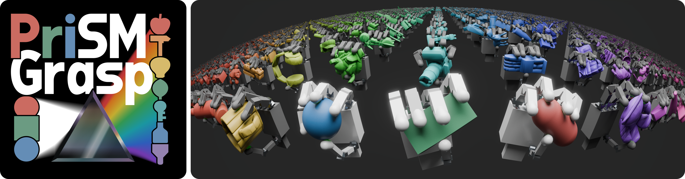

# PriSM-Grasp

A generalizable dexterous grasping policy trained using only three families of geometric primitives.

We introduce the Primitive-Based Scalable Method for Dexterous Grasping (**PriSM-Grasp**), a framework that learns a generalizable dexterous grasping policy using only generated geometric primitives as training objects and achieves over 93% grasp success in simulation across three dexterous hands.

## Simulation Results

| Dexterous hand | Grasp success rate |
| --- | ---: |
| ParaHand | 93.69% |
| Wuji 2 | 93.47% |
| Sharpa Wave | 93.99% |

## Repository

Coming soon...
